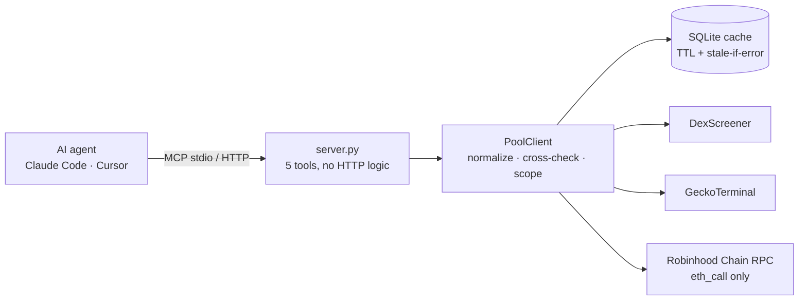

# mcp-defime

   

A **Model Context Protocol (MCP) server** that gives AI agents (Claude Code, Cursor, any MCP client) live,
verifiable data on **tokenized-asset liquidity pools on Robinhood Chain** — tokenized stocks and ETFs (RWA)
and blue-chip crypto (ETH, WETH, cbBTC), quoted against USDG.

Built so an agent **knows what it doesn't know**: every answer says where each number came from, when it was
fetched, whether it came from cache, what was computed and how, and which fields the sources did not provide.

## Tools

| Tool | What it answers |
|---|---|
| `defime_get_pool` | Current state of a pool: price, TVL, volume (5m/1h/6h/24h), nominal fee **and the fee that actually reaches the LP**, fees and APR 24h, tokens, cross-check between sources, plus an `onchain` block read from the contract |
| `defime_get_pool_history` | Volume, fees, APR and price per period (`1d`, `7d`, `30d`, `90d`) with a summary |
| `defime_compare_pools` | 2–5 pools side by side, with the leader of each metric; a failing pool doesn't break the others |
| `defime_list_pools` | Pools in scope sorted by volume, TVL or APR; filter by `category` (`rwa` / `bluechip`) and minimum TVL |
| `defime_search_pools` | Search by symbol, name or address (e.g. `MU`, `PLTR`, `cbBTC`, `0xb196…`) |

Pools can be passed as a DexScreener or GeckoTerminal URL, as a `chain_0x…` slug, or as `chain` + `pool_id`
(40-hex address or 64-hex Uniswap v4 PoolId). Full reference: [docs/MCP_TOOLS.md](docs/MCP_TOOLS.md).

Example prompts once it's connected:

> "Which RWA pools on Robinhood Chain have the highest TVL?"
> "Compare the MU/USDG and PLTR/USDG pools and tell me which one pays LPs more — and how sure you are."

## Why it's different

- **RWA verified by the contract, never by the symbol.** The chain has ~20 fake tokens called "USDC". A token
  only counts as a Robinhood stock token if its EIP-1967 beacon slot points to Robinhood's beacon.
- **The real LP fee, read on-chain.** On Robinhood Chain, V3 pools with `feeProtocol` deliver 5/6 of the
  nominal fee to LPs, and V4 pools discount the protocol fee. Aggregators' "APR" uses the nominal fee and comes
  out ~20% high; this server returns both and tells the agent to use `apr_24h_lp_pct` for LP yield.
- **No invented data.** Missing values are `null` and listed in `missing_fields`; anything we compute (fees,
  APR) is listed in `derived_fields` with its formula. Every response carries `sources`, `retrieved_at` and
  `cache {hit, age_seconds, stale}`.
- **Read-only.** On-chain access is `eth_call` against public RPCs only — no keys, no signing.

## Architecture



- **Sources:** DexScreener (primary for TVL, volume, price), GeckoTerminal (fee tier, history, listing, search)
  and on-chain reads (fee, tick, liquidity, sqrtPrice, V4 hooks and dynamic fee).
- **Resilience:** retries with exponential backoff only on 5xx/timeouts/429, `Retry-After` honored, per-host
  rate limiting, SQLite cache with per-type TTL and **stale-if-error**, a second RPC as fallback, and
  **schema-drift detection** — if a source changes its format, the tool returns a clear error instead of
  silently wrong data.

## Quick start

```bash
git clone https://github.com/leandrosmoreira53/mcp-defime && cd mcp-defime
python -m venv .venv && source .venv/bin/activate   # Windows: .venv\Scripts\activate
pip install -e ".[dev]"
cp .env.example .env
pytest                                              # 75 offline tests, no network
```

### Claude Code (local, stdio)

```bash
claude mcp add defime -- /path/to/mcp-defime/.venv/bin/python -m defime_mcp.server
```

### Cursor (`~/.cursor/mcp.json`)

```json
{ "mcpServers": { "defime": { "command": "/path/to/mcp-defime/.venv/bin/python", "args": ["-m", "defime_mcp.server"] } } }
```

### Remote (HTTP, behind a reverse proxy)

```bash
MCP_TRANSPORT=http MCP_AUTH_TOKEN=<random-32-bytes> python -m defime_mcp.server
claude mcp add --transport http defime https://your-domain/mcp --header "Authorization: Bearer <token>"
```

Generate the token with `python -c "import secrets;print(secrets.token_urlsafe(32))"`. HTTP mode refuses to
start without a token of at least 24 characters, compares it in constant time and enables DNS-rebinding
protection (`MCP_ALLOWED_HOSTS`). Docker, docker-compose, systemd, nginx and Caddy examples are in
[`deploy/`](deploy) and the [Dockerfile](Dockerfile).

## Configuration

All settings come from environment variables (see [.env.example](.env.example)): cache TTLs, rate limit,
timeouts and retries, scope (`rwa_bluechip` or `all`), token lists, on-chain RPC URLs, transport, host/port,
auth token and allowed hosts.

## Tests

```bash
pytest            # 75 offline tests on recorded fixtures (respx mocks HTTP)
pytest -m live    # optional: hits the real APIs and cross-checks sources
```

Covered: pool id parsing, success / not found / timeouts / 429 with `Retry-After` and with retries exhausted /
5xx retry, one source down, missing fields → `null` + `missing_fields`, schema drift → typed error, cache
hit and expiry, stale-if-error, on-chain decoding (V3 fee protocol, V4 PoolKey and dynamic fee), RPC fallback,
scope rules (RWA by contract, meme pools out of scope), bearer auth and the MCP tools end to end.

## License

[MIT](LICENSE) © 2026 Leandro Moreira · [leandrosmoreira.dev](https://leandrosmoreira.dev)
